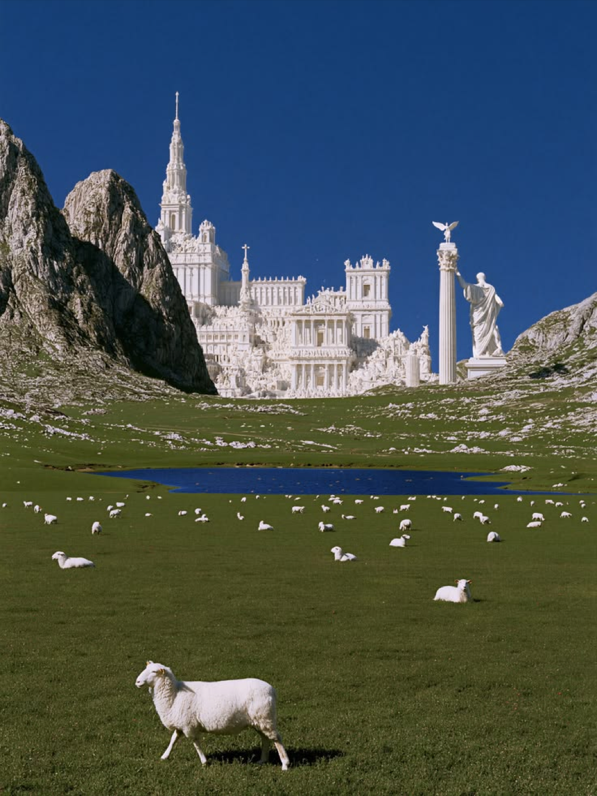
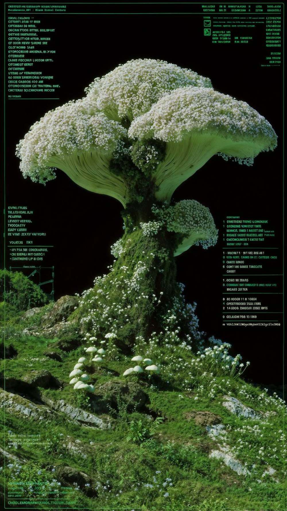
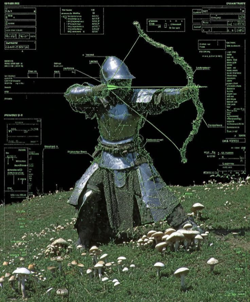
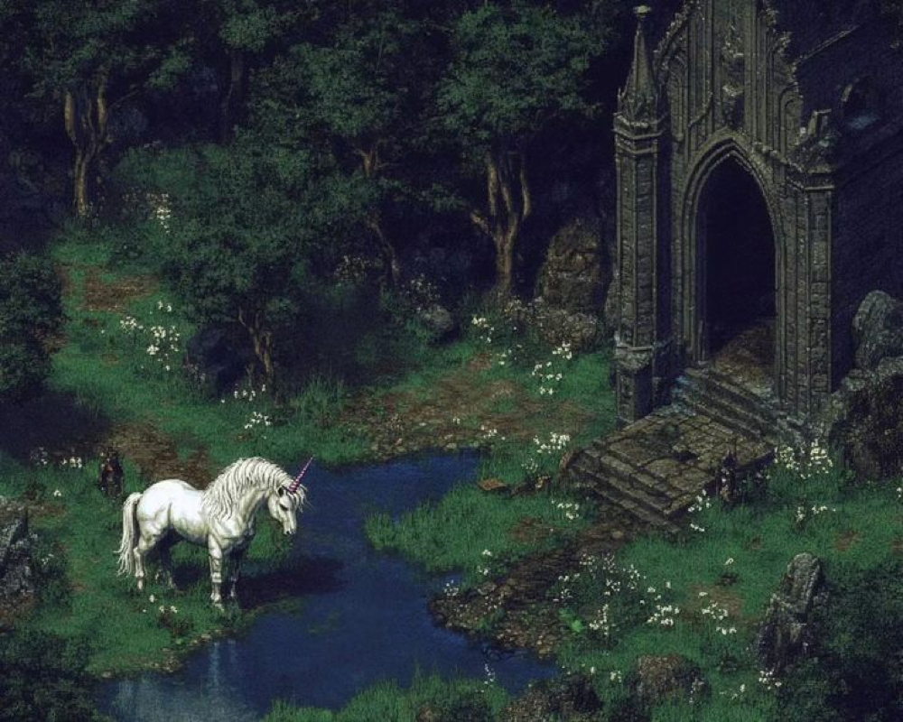
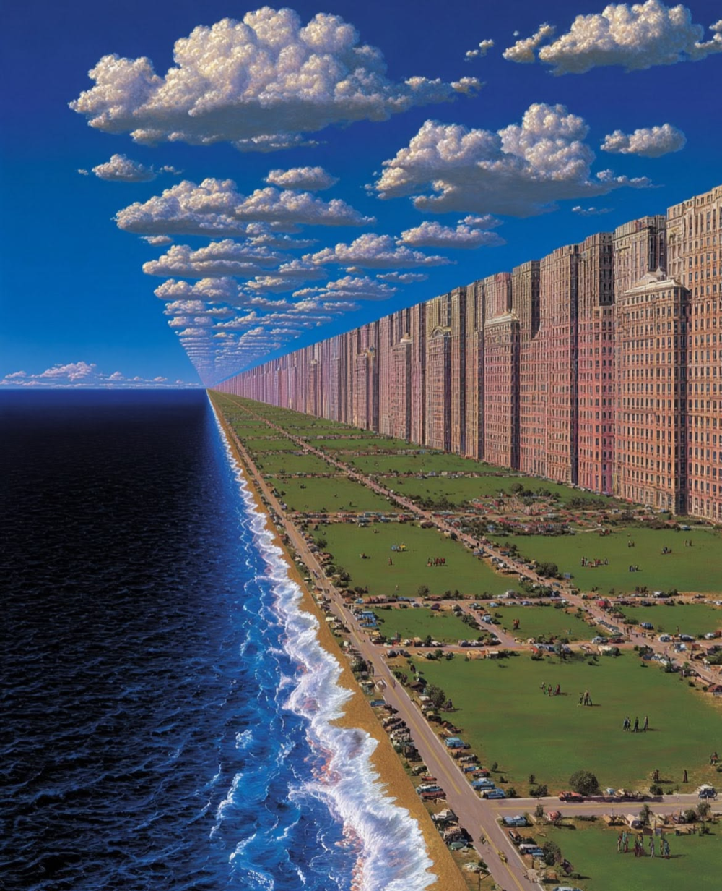

  

  

  <code>ARCHIVE NODE // VER 2002.11 // CHANNEL OPEN</code>

  

## [01] Field archive

**SwagaLabs** — место для сервисов, инструментов и экспериментов. Не витрина с героями, а старый системный терминал: полевые сканы, гербарий, схемы и рабочие артефакты в одном архиве.

  

  

| `SERVICES` | `TOOLS` | `LAB` |
| :---: | :---: | :---: |
| Backend, API и прикладная логика. | Утилиты, автоматизация и маленькие полезные штуки. | Прототипы, визуальные эксперименты и незакрытые вопросы. |

  

## [02] Archive fragments

  
  
  

  
  

  

## [03] Signal

Если что-то здесь помогло — ставь звезду, открывай issue или приноси идею. Пишем по делу, не притворяемся корпорацией и держим архив живым.

SWAGA LABS · FIELD ARCHIVE · NO HEROES ON THE POSTER

