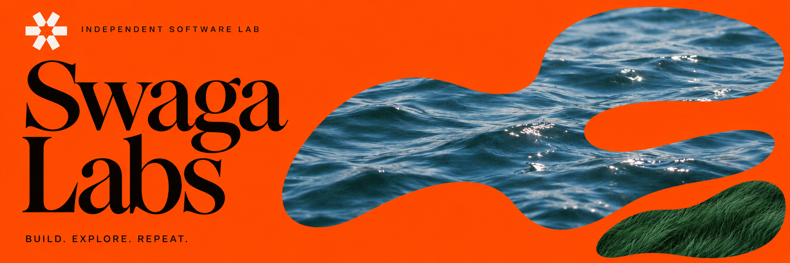
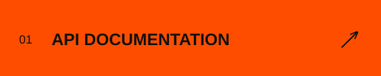
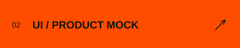
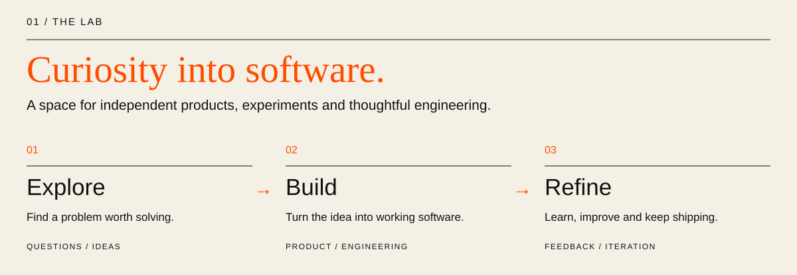
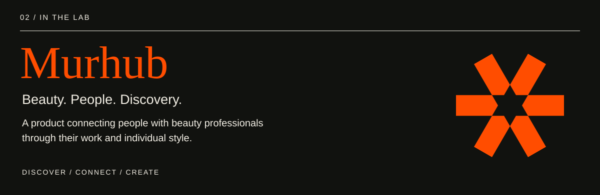

  

<strong>Independent minds. Shared curiosity. Things worth building.</strong>

  We build products, explore ideas and learn by making things real.

  
  
  

 

 

| Inside Murhub | Explore |
| :--- | :--- |
| Product & engineering | [Source code](https://github.com/swagalabs/murhub-mp) |
| API reference | [Documentation](https://swagalabs.github.io/murhub-api/) |
| Interface explorations | [UI mock](https://swagalabs.github.io/murhub.docs/) |

 

