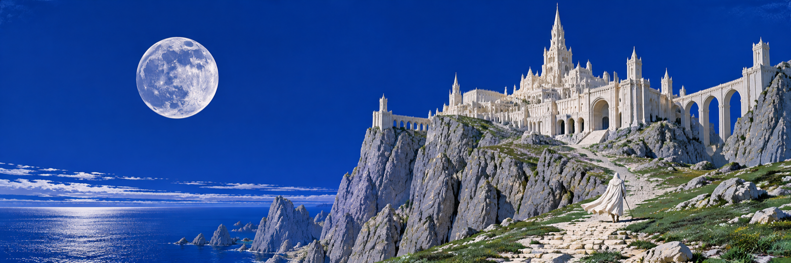
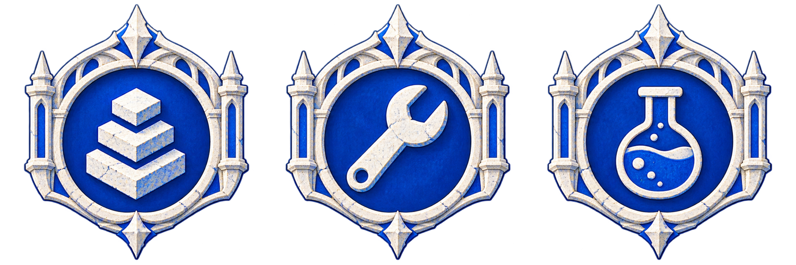
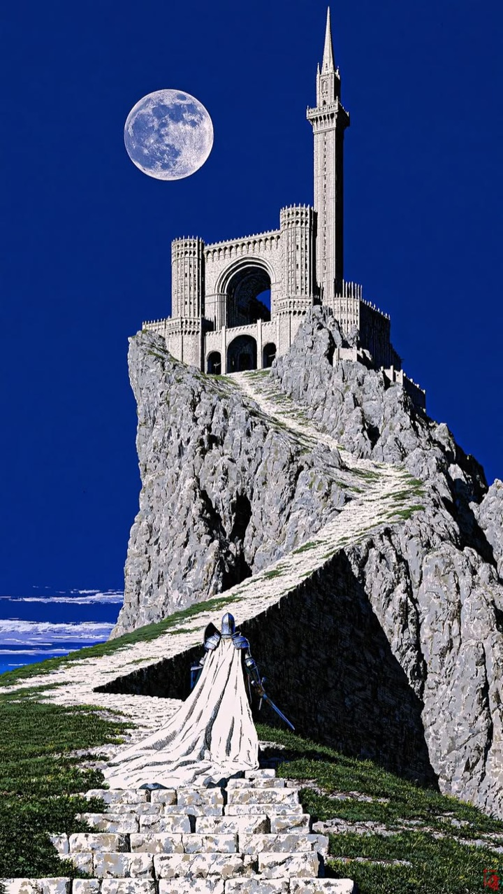

**Build strange things under a wide blue sky.**

---

## A quiet place for working things

SwagaLabs builds services, tools and experiments that are useful enough to keep. The landscape is spacious; the work is concrete.

| Services | Tools | Lab |
| --- | --- | --- |
| APIs, backend and product logic. | Small utilities and automation. | Prototypes and things worth testing. |

---

## The long way up

White stone, ultramarine sky and a single clear direction. The rest is work.

---

`SWAGA LABS · ULTRAMARINE / WHITE STONE / OPEN HORIZON`
